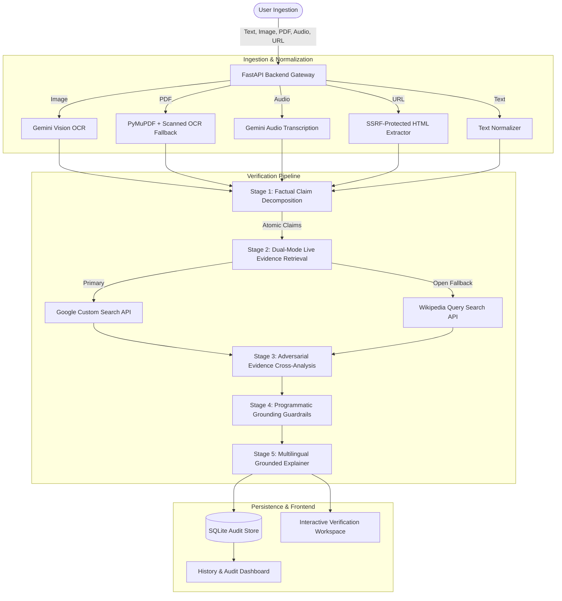

# TruthLens AI 🔍
### Evidence-Grounded Multimodal Claim Verification System

[](https://python.org)
[](https://fastapi.tiangolo.com)
[](https://react.dev)
[](https://typescriptlang.org)
[](https://vitejs.dev)
[](https://sqlite.org)
[](https://github.com/Omsri456/TruthLens)

---

## 📌 Executive Summary

**TruthLens AI** is a production-ready, full-stack claim verification platform that combats viral misinformation, forwarded rumors, and misleading claims across **5 input formats**:
- **Plain Text** (forwarded messages, social media posts)
- **Screenshots & Images** (WhatsApp screenshots, circulars via Gemini Vision OCR)
- **PDF Documents** (government notifications, circulars via PyMuPDF with scanned document OCR fallback)
- **Voice Notes & Audio** (audio recordings transcribed via Gemini)
- **Web URLs** (articles extracted via an enterprise SSRF-protected parser)

Unlike naive LLM chatbots that hallucinate facts or invent fake URLs, TruthLens AI uses **Retrieval-Grounded Adversarial Verification**:
1. It decomposes user content into **atomic factual claims**.
2. It retrieves **real, verifiable evidence** from live public sources (Google Custom Search API + Wikipedia open retrieval).
3. It performs **adversarial cross-analysis**, categorizing evidence into supporting vs. contradicting sources.
4. It enforces **deterministic code-level safety guardrails** (e.g., a claim cannot be marked `VERIFIED` without verified supporting citations).
5. It produces **plain-language explanations** in **English, Hindi (हिंदी), or Marathi (मराठी)** with direct, clickable citations.

---

## 🏛️ System Architecture



---

## 🎯 5-Tier Verdict Taxonomy

TruthLens AI avoids binary true/false oversimplifications by categorizing claims into 5 standardized categories:

| Verdict | Meaning | Grounding Requirement |
| :--- | :--- | :--- |
| **`VERIFIED`** | Claim is directly substantiated by authoritative evidence. | **Strictly requires $\ge 1$ supporting citations.** Never assigned without proof. |
| **`FALSE`** | Claim is directly refuted, fabricated, or contradicted by credible sources. | Requires contradicting source citations or authoritative refutations. |
| **`OUTDATED`** | Claim was historically accurate in the past, but is superseded by newer updates. | Explains the historical context vs. current reality. |
| **`PARTIALLY_SUPPORTED`** | Core premise is true, but key figures, dates, or implications are distorted. | Highlights exact numerical or factual discrepancies. |
| **`CANNOT_BE_CONFIRMED`** | Insufficient or conflicting public reporting exists. | Transparently admits gaps in available evidence rather than guessing. |

---

## 🛡️ Anti-Hallucination & Security Guardrails

- **Zero Fabricated URLs:** Every source link displayed in TruthLens originates from a live HTTP search API response. The LLM is never allowed to generate URLs.
- **Strict Temperature Lock:** Gemini inference temperature is set to `0.1` with strict Pydantic JSON schema parsing.
- **Enterprise SSRF Protection:** The URL ingestion engine actively blocks loopback addresses (`127.0.0.1`, `localhost`), private LAN subnets (`192.168.0.0/16`, `10.0.0.0/8`, `172.16.0.0/12`), cloud metadata endpoints (`169.254.169.254`), and unauthorized schemes (`file://`, `ftp://`).
- **Free-Tier Friendly:** Runs on Google AI Studio's **100% Free Tier** (`gemini-1.5-flash`), paired with **free live open Wikipedia retrieval**. No credit card required.

---

## ⚡ Quick Start Guide

### Prerequisites
- Python 3.11+
- Node.js 18+

### 1. Installation
Clone the repository:
```bash
git clone https://github.com/Omsri456/TruthLens.git
cd TruthLens
```

Install backend dependencies:
```bash
pip install -r backend/requirements.txt
```

Install frontend dependencies:
```bash
cd frontend && npm install && cd ..
```

### 2. Environment Configuration (Optional)
Copy the environment template:
```bash
cp .env.example .env
```
*(Optional: Add your `GEMINI_API_KEY` from Google AI Studio. Live search retrieval works out-of-the-box via open search endpoints even without API keys!)*

### 3. Launch Services
From the root directory (`TruthLens`), open two terminals:

**Terminal 1 — Backend Server:**
```bash
npm run dev:server
```
*API running at `http://localhost:8000` (Interactive docs at `http://localhost:8000/docs`)*

**Terminal 2 — Frontend Client:**
```bash
npm run dev:client
```
*Web application live at `http://localhost:5173`*

---

## 🧪 Testing & Benchmark Evaluation

### Run Automated Test Suite
TruthLens AI includes 27 comprehensive automated tests:
```bash
pytest backend/tests/ -v
```
```text
======================= 27 passed in 6.35s =======================
```

### Run Benchmark Evaluation
Evaluate real-world retrieval recall and citation validity:
```bash
python evaluation/evaluate.py
```
```text
======================================================================
EVALUATION BENCHMARK SUMMARY REPORT
======================================================================
Total Benchmark Claims Tested: 8
Evidence Retrieval Recall:     87.5% (7/8)
Source URL Validity Rate:      100.0%
HTML Snippet Sanitization:     100.0%
Grounding Guardrail Checks:    PASSED (Zero ungrounded VERIFIED assignments)
======================================================================
```

---

## 📁 Project Structure

```text
TruthLens/
├── backend/
│   ├── app/
│   │   ├── api/routes.py              # REST API endpoints
│   │   ├── core/config.py             # Pydantic v2 settings & limits
│   │   ├── db/database.py             # SQLite models & auto-init
│   │   ├── schemas/models.py          # Pydantic contract models
│   │   ├── services/
│   │   │   ├── extraction/            # OCR, PyMuPDF, audio, SSRF-safe URL
│   │   │   ├── llm/provider.py        # Gemini client & multilingual prompts
│   │   │   ├── retrieval/search.py    # Google CSE + Wikipedia open search
│   │   │   ├── reporting/persistence.py# Report storage & history management
│   │   │   └── verification/engine.py # Core orchestrator & grounding guardrails
│   │   └── main.py                    # FastAPI application entry point
│   ├── tests/                         # 27 automated unit/integration tests
│   └── requirements.txt
├── frontend/
│   ├── src/
│   │   ├── pages/
│   │   │   ├── VerifyPage.tsx         # 5-mode input workspace + previews
│   │   │   ├── ReportPage.tsx         # Evidence breakdown & source cards
│   │   │   ├── HistoryPage.tsx        # Filterable audit log & record deletion
│   │   │   └── AboutPage.tsx          # Live health check & methodology
│   │   ├── services/api.ts            # Typed Axios client
│   │   ├── types/index.ts             # TypeScript domain types
│   │   ├── index.css                  # Custom design system & verdict styles
│   │   └── App.tsx                    # Routing & navigation
│   └── package.json
├── evaluation/                        # Benchmark dataset & evaluation runner
├── samples/                           # Ready-to-test sample files (.txt, .pdf)
├── package.json                       # Root script runners (dev:server, dev:client)
├── .env.example                       # Environment template
└── README.md                          # Project documentation
```

---

## 🔌 API Endpoints Reference

| Method | Endpoint | Description |
| :--- | :--- | :--- |
| `GET` | `/api/v1/health` | Service health status and LLM/Search configuration flags |
| `POST` | `/api/v1/verify/text` | Verify claims from raw text input |
| `POST` | `/api/v1/verify/image` | Upload image for Gemini Vision OCR and verification |
| `POST` | `/api/v1/verify/pdf` | Upload PDF for PyMuPDF extraction and verification |
| `POST` | `/api/v1/verify/audio` | Upload voice note for transcription and verification |
| `POST` | `/api/v1/verify/url` | Safely extract article body via URL and verify |
| `GET` | `/api/v1/verification/{id}` | Retrieve full report by verification ID |
| `DELETE` | `/api/v1/verification/{id}` | Delete a specific verification report |
| `GET` | `/api/v1/history` | List recent verification history |
| `DELETE` | `/api/v1/history` | Clear all verification records |

---

## 👥 Hackathon Presentation Summary

- **Problem:** Millions of citizens receive forwarded WhatsApp claims without an easy way to verify them or read official sources in their native language.
- **Solution:** A multimodal, evidence-grounded AI investigator that extracts claims, searches real sources, and explains the findings in English, Hindi, or Marathi with traceable links.
- **Why It Wins:** It does not merely generate chatbot text—it retrieves **live verified proof**, enforces **strict programmatic guardrails against hallucinations**, and supports **5 multimodal input channels**.
